# uuu: the company engine

The company engine runs a small company end to end with one owner and a team of AI agents, on one Mac. You say what you want done in plain words. A Chief of staff agent sizes the work and hands it out, the agents do it inside a locked-down space called the fence, a Checker agent checks it, and the result waits in **Needs you** until you accept it or send it back. The tasks live on a board (Paperclip), the books and customers live in Frappe, and your own files are the company brain every agent reads first. Keys, money and every on/off switch stay with you on the Mac. Nothing is published or sent anywhere by the engine.

<picture>
  <source media="(prefers-color-scheme: dark)" srcset="docs/images/map-dark.webp">
  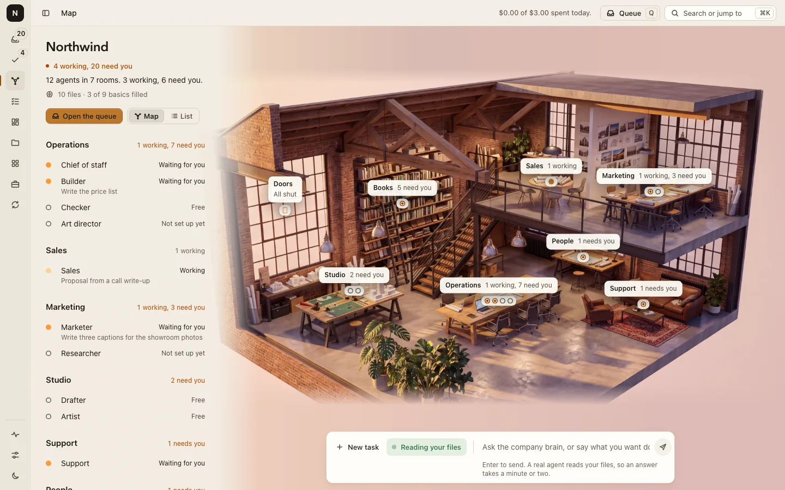
</picture>

<sub>Every screenshot in this README was taken from a staged copy of the engine filled with made-up test data (a company called "Northwind"). None shows real company data, keys or accounts.</sub>

## Contents

- [How it works](#how-it-works)
- [A tour of the home screen](#a-tour-of-the-home-screen)
- [Safety](#safety)
- [App Studio](#app-studio)
- [The Mac app](#the-mac-app)
- [A second PC on Windows](#a-second-pc-on-windows)
- [Running it](#running-it)
- [Repository map](#repository-map)
- [Testing](#testing)
- [Decisions and further reading](#decisions-and-further-reading)
- [License](#license)

## How it works

### The parts


| Part | What it is |
| --- | --- |
| **Home screen** | Your one front door, a web page on `http://127.0.0.1:3200` that only this Mac can open. Map, Tasks, Needs you, Files, Jobs, Dashboards, App Studio, Settings and Health. |
| **Board** | Where tasks and agents are kept and handed out. It is [Paperclip](https://www.npmjs.com/package/paperclipai), pinned to one version in `engine/package.json`. |
| **Agents** | Twelve roles in seven departments: Chief of staff, Builder, Checker, Art director, Bookkeeper, Sales, Support, People, Marketer, Researcher, Drafter and Artist. They run on Claude Code and Codex. |
| **The fence** | The limits around every agent: it may write only in its own task folder, reaches no outside host but its own model service, holds no keys and has no direct way to the board. It is built with Anthropic's sandbox runtime, and its rules come only from files the engine writes. |
| **The gate** | A small server between the agents and the board. It turns away every request an agent has no need to make. |
| **The model relay** | The one way to an outside model provider (Omega Plus), closed unless you switch it on. It adds the key itself, so the key never enters the fence. |
| **The doors** | Small servers that each let one agent do one outside thing, each off until you switch it on: the **web door** (the Researcher reads public pages), the **generation door** (clips and pictures from Runway and Higgsfield), the **page viewer** (a hidden Chrome that takes pictures of pages the Builder made) and the **brain door** (searching your files). |
| **Books** | One Frappe bench with ERPNext and India Compliance (the books), Frappe CRM (customers), Helpdesk (support) and HRMS (people). |
| **Company brain** | Your own files: nine short basics (about the company, brand, prices, terms and so on) and ten folders. Every agent reads them before it works. Only you write in them. |

### How one piece of work flows

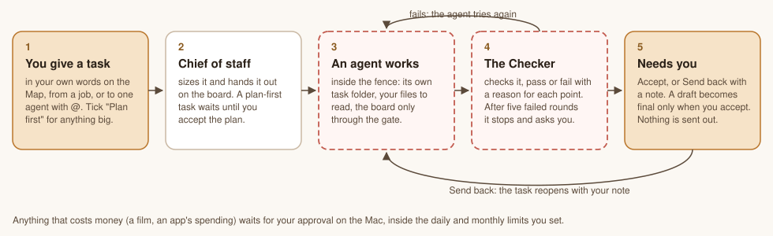

1. **You give a task** in the box on the Map, in your own words. Or you start one of 72 ready-made jobs, or send it to one agent with `@`. Tick "Plan first" and nothing is done until you accept the plan.
2. **The Chief of staff** sizes it and hands it out on the board.
3. **An agent works inside the fence.** It reads its task through the gate, reads your files and writes only in its own task folder.
4. **The Checker** checks the result against numbered points, each pass or fail with a reason. Work that fails goes back to the agent. After five failed rounds the task stops and asks you.
5. **Needs you.** The finished work waits for you. **Accept** makes it final; **Send back** reopens it with your note. A question from an agent also waits here, and work carries on once you answer.

Anything that costs money works the same way, with one more step: you approve the cost on the Mac first, inside daily and monthly limits you set, and the engine counts every cent in its own record.

## A tour of the home screen

### Map

The company as a place: a room per department, the agents and what each one is doing, how much has been spent today, and one box to give a task or ask a question about the company. A question is answered from your files, names the files it used and says what they do not cover. Above is the Map in light and, if your GitHub is in dark mode, in dark.

### Tasks

Every task as a list or a board, grouped by what it needs: needs you, working, stuck, done. Filter by state, department or agent.

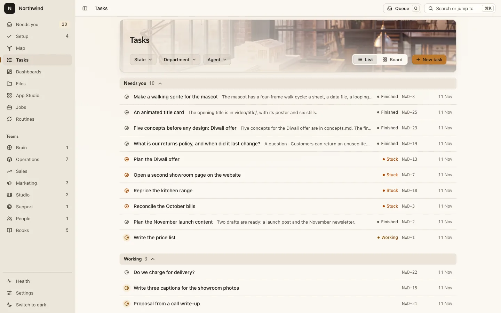

### A task: the acceptance view

Open a task to see who did it and how many check rounds it took, the Checker's numbered checks with a tab per round, the conversation, the brief, the plan and the files. When it is waiting for you there is one Accept button and a Send back button.

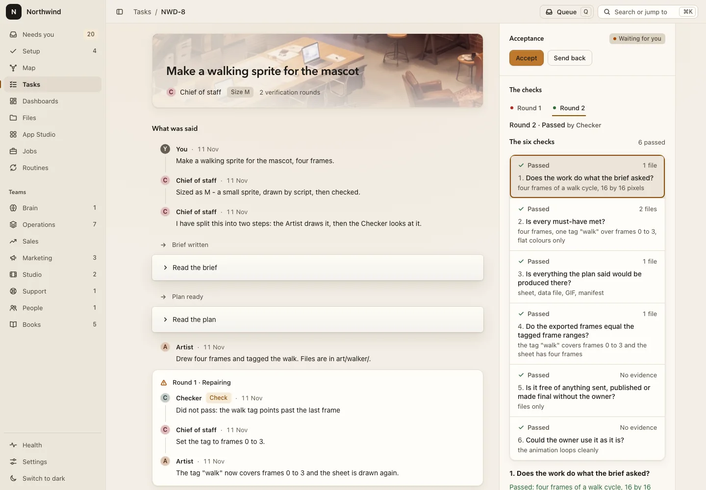

### Needs you

Everything waiting for you, as cards with one main button each: to approve, to answer, to accept and to know. It opens as a drawer from any page, or as a full page where J and K move between cards.

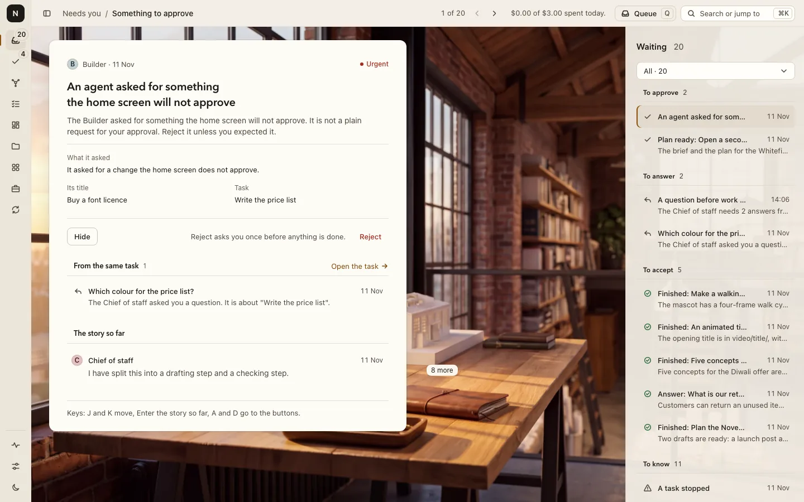

### Setup

The first time you open the home screen with no tasks, it opens Setup. Six steps are needed to start: models, the fence check, the company basics, the brand kit, the books and a first real task. Optional steps (the web, Runway, Higgsfield, App Studio, the brain and others) say what each one opens up and what it costs or sends off the Mac. Setup only looks and points: it saves no key and switches nothing on.

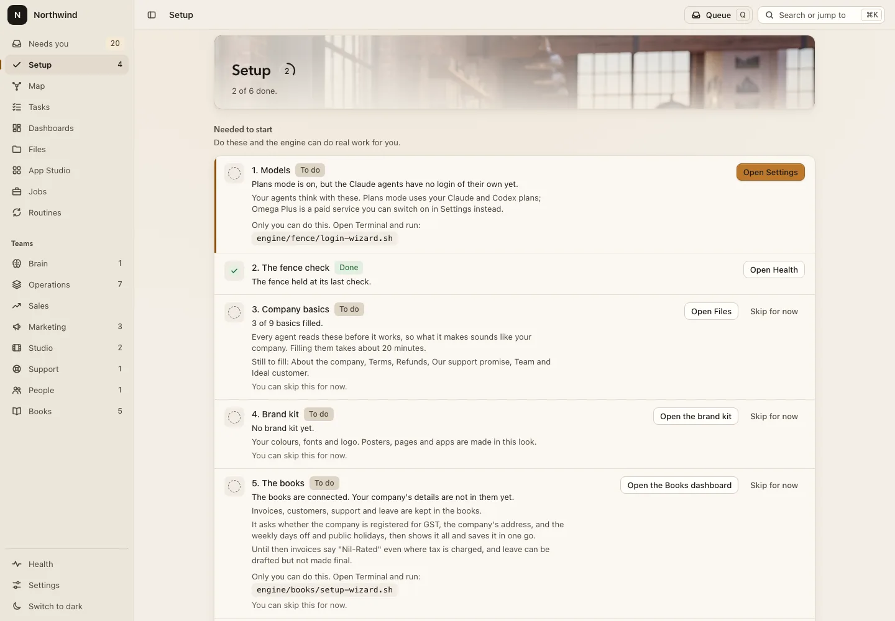

### Files: the company brain

Your own files, in ten folders, with the nine basics filled through short forms. Add a file by form, paste or upload; search across all of it; read and change the lessons the agents have learned. Agents cannot write here: anything they want kept comes to you as a draft.

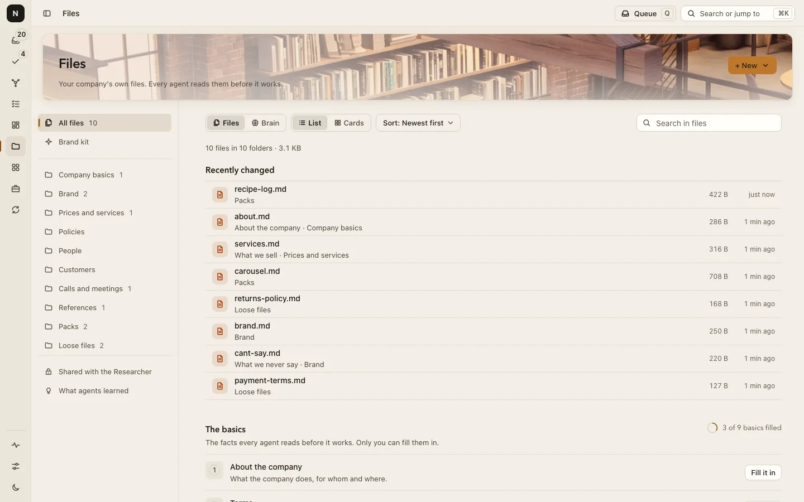

### Jobs

72 named pieces of work in seven departments (Operations, Sales, Marketing, Studio, Support, People and Books). Each has a hand-off tag ("You lead", "You approve" or "On its own") and a place in the build order. A job that cannot start says why, for example that it needs the web switched on.

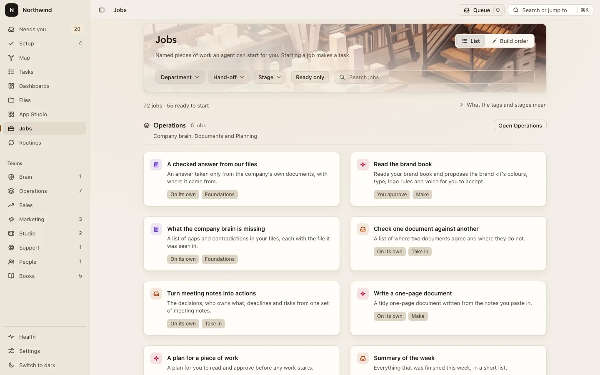

### Dashboards: the Studio

Dashboards show figures first, then drafts waiting for you, for Books, Customers, Support, People, Marketing and Studio. The Studio holds what the Artist and the Drafter make: films, videos, slide carousels, sprites, pictures and measured parts.

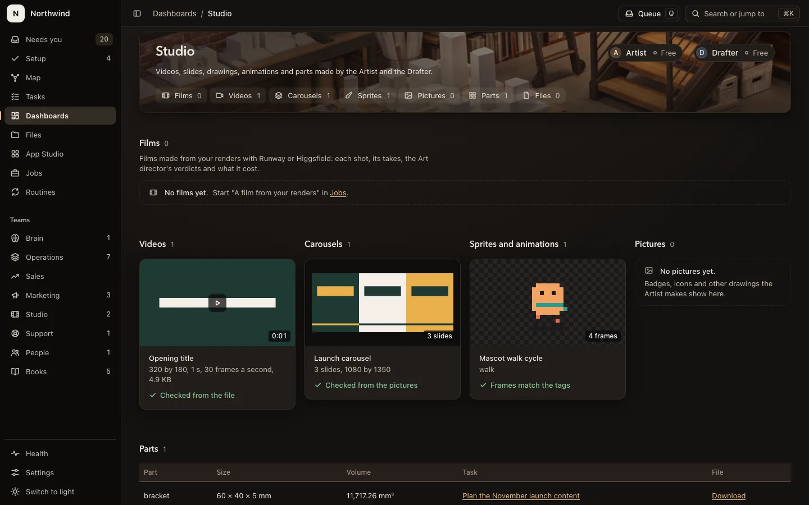

### Settings

Theme, the models each agent uses, and every outside service with its own switch. Keys are pasted once, kept outside the fence and never shown again. Generation shows the two spending limits, what has been spent, and a warning about each service's terms before you switch it on.

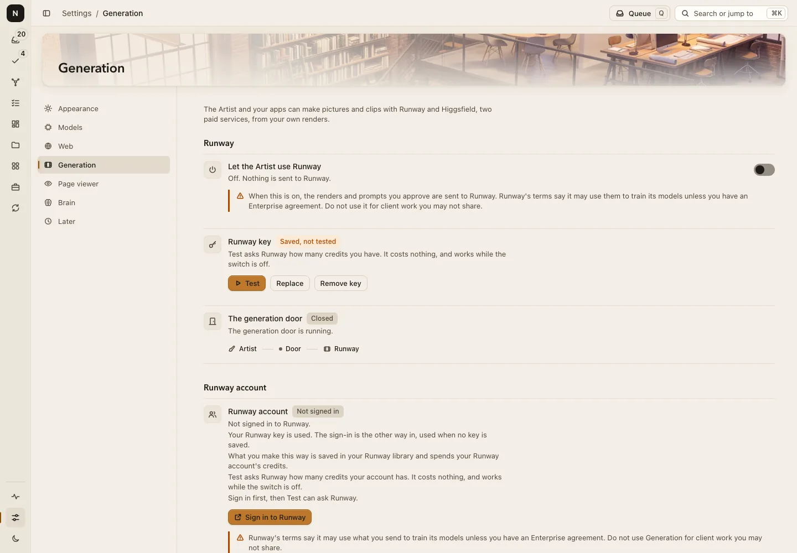

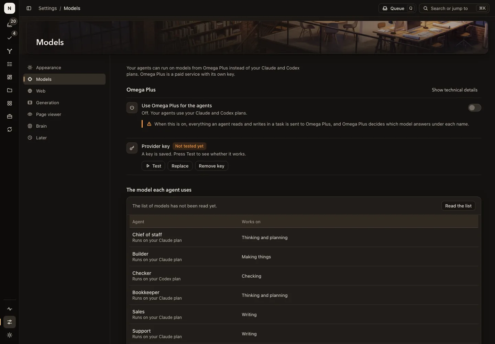

### Health

What is on, whether the fence held at its last check, and what is not set up yet, each with the one thing to do next. You can run the fence proof from here.

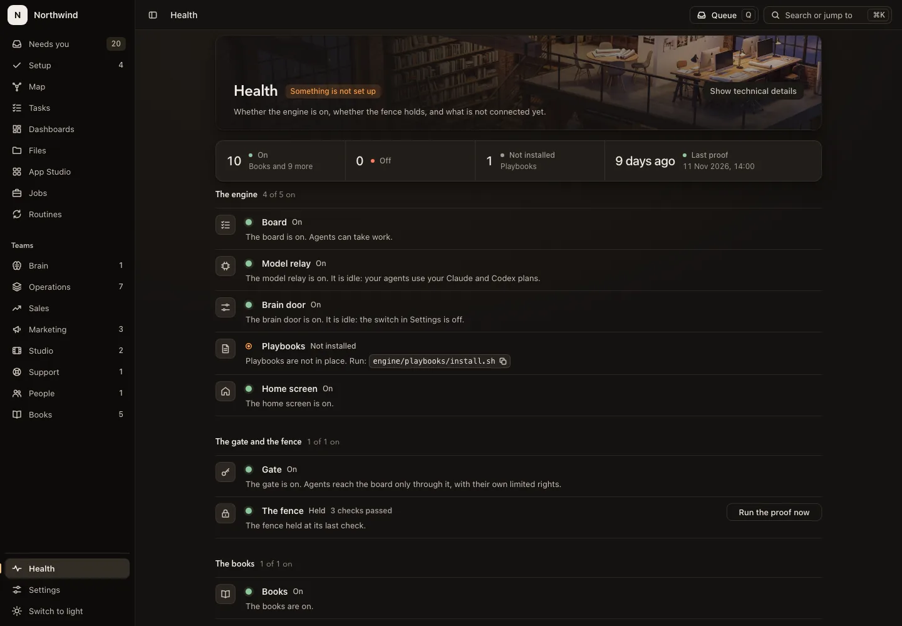

### On a phone-sized window

The sections move to a bar at the bottom and the Map becomes a small picture over a plain list.

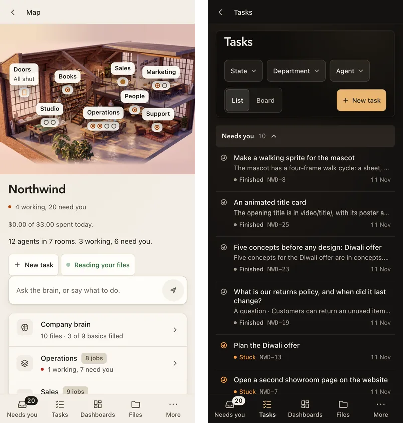

## Safety

The engine is built on one idea: agents can do the work, but they cannot reach anything they do not need, and they can never spend money, change a setting or send anything on their own.

- **The fence.** Every agent runs inside a fence built with Anthropic's sandbox runtime. It can write only in its own task folder (and append to its own lessons file), read only the folders its policy names, and reach no outside host except the model service it runs on (and, with Omega Plus switched on, not even that: only the gate and the model relay). Its rules come from files the engine writes, never from the agent's environment, so an agent cannot widen its own fence. `engine prove` checks that the fence holds; at its last recorded run it passed 204 checks with 0 failures.
- **The gate.** Agents never talk to the board directly. The gate lets each agent make only the requests its role needs and logs what it turned away.
- **Keys never leave the Mac and never enter the fence.** Keys and sign-ins live in a secrets folder only you can read. The model relay and the doors add them on the way out; no agent and no app can read them.
- **Everything outside is off by default.** The web, Runway, Higgsfield, the page viewer, Omega Plus, the brain door, routines and every app start switched off. Each switch in Settings says, before you turn it on, what would leave the Mac.
- **Spending limits and approvals.** Runway and Higgsfield share one daily and one monthly limit in dollars (they start at $3 and $10). A film shows its cost on a card in Needs you and nothing is sent until you press "Approve and spend up to ...". An app can spend only inside a daily allowance you open in the bar above it ($2, $5, $10 or $20), which ends at midnight or when you press "Stop spending". The generation door keeps its own record of every cent and refuses anything that would go over a limit, or anything at all if it cannot read that record.
- **Nothing is published or sent.** No email, message or post can go out. Publishing needs an account you connect first, and none is connected.
- **The remote door is off by default.** A Windows PC can only show the home screen, only after you allow it in Terminal on the Mac, and never handles keys, switches or money (see below).

The full reasoning for each of these is in [`docs/adr/`](docs/adr/).

## App Studio

App Studio runs apps the company made, kept in this repository under [`apps/`](apps/), on the Mac only. Each app's program runs inside its own fence: it can reach no internet and no port on the Mac, read none of your files or keys, and reach Runway, Higgsfield and the model relay only through one socket to the engine, inside the allowance you set. Its page runs in your browser, so the tile says plainly: turn on only an app whose code you trust.

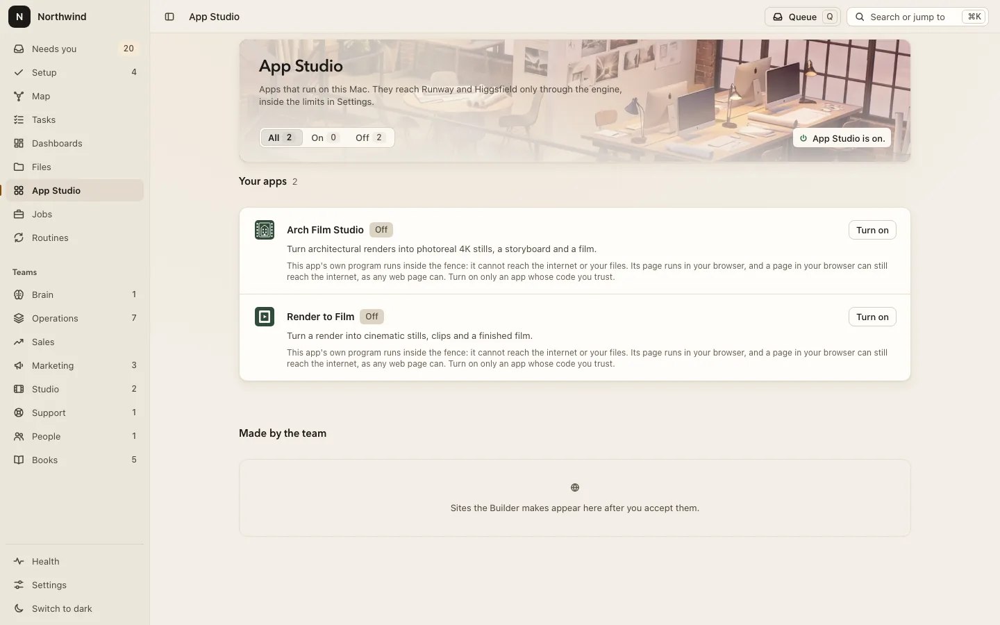

- **[Render to Film](apps/render-to-film/README.md)** turns one render into cinematic stills, clips and a finished film, in seven tabs: Director, Stills, Video, Close-ups, Location, Edit and Library. Every button that spends shows its price first.
- **[Arch Film Studio](apps/arch-film-studio/README.md)** turns a whole project of architectural renders into photoreal 4K stills, a storyboard and a film, in six stages: Upload, Enhance, Review, 4K masters, Storyboard and Film. Each picture is approved before the next stage, and a locked master never changes.

Both start switched off. The app screens themselves are not shown here: their programs only start inside their fence on the engine's fixed app ports, which a staged copy with test data does not use, so they could not be photographed without the live engine.

## The Mac app

**Company Engine** is the same home screen in its own Mac window, written in plain Swift on AppKit and WebKit with no dependencies. It adds what a browser tab cannot: a count of what needs you on the Dock, a menu bar item, a notice when something new needs you (it says only how many), a switch that keeps the Mac awake while agents work, and Start and Stop for the engine. It shows one address only, never starts the engine by itself, and quitting it does not stop the engine.

```sh
engine/mac/build.sh --install   # builds it and puts it in ~/Applications; no administrator password
```

How it is built and checked: [`engine/mac/README.md`](engine/mac/README.md). Why it is safe: [ADR 0020](docs/adr/0020-a-mac-app-outside-the-fence-that-shows-one-address.md).

## A second PC on Windows

A Windows PC on the same office network can open a window on the Mac's home screen. The engine, its keys, its data and its agents stay on the Mac; the PC only shows its screens. It uses only what Windows already has (its own `ssh` and Microsoft Edge), and nothing is downloaded on either computer.

The Mac runs a **remote door** that is off until you turn it on in Terminal, lets in only PCs you allowed one by one (up to five), and can do nothing but carry each PC's window to the home screen. You add a PC with two walks of a USB stick:

```sh
engine/bin/engine remote kit /Volumes/<stick>       # write the set-up kit to a USB stick
# on the PC: double-click "Set up" in the kit; it writes seat-request.txt back to the stick
engine/bin/engine remote allow <seat-request.txt>   # check the PC's code, then type yes
engine/bin/engine remote on                         # open the door (type yes)
engine/bin/engine remote seats                      # list the PCs
engine/bin/engine remote off                        # close the door (type yes)
```

A `desk` PC can read everything, make tasks, answer, accept or send back work that has no price, and write files. A `view` PC only reads. On every PC, keys, Test buttons, switches, sign-ins, limits, allowances and anything with a price stay on the Mac, and the PC shows "You are on a second PC. Keys, switches and money stay on the Mac." It has not yet been run on a real Windows PC. Details: "The Windows app" in [`engine/README.md`](engine/README.md#the-windows-app) and [ADR 0023](docs/adr/0023-a-window-on-another-computer-through-a-forward-only-door.md).

## Running it

The engine runs on one Mac and listens only on `127.0.0.1`. The owner's guide, [`engine/README.md`](engine/README.md), is the full manual; this is the short version.

### What you need

- A Mac. The Mac app needs macOS 14 or later.
- Node.js 24 (`engine/package.json` asks for 24.11 or later). `engine/config.json` names the Node 24 install the engine uses, along with its ports and its state folder.
- Python 3, for the fence and the tests.
- Claude Code and Codex, signed in on your own plans. Those plans are the only thing the engine needs you to pay for. Omega Plus, Runway and Higgsfield are optional and off by default.
- About 9 GB of free disk for the books (their installer refuses with less).
- Google Chrome, only if you want the page viewer.

### First run

```sh
engine/books/install.sh            # install the books (Frappe); safe to run again
(cd engine && npm ci)              # the two pinned packages: Paperclip and the sandbox runtime
engine/fence/login-wizard.sh       # the Claude agents' own login (only you can do this)
engine/fence/login-wizard.sh codex # the Checker's own Codex login
engine/bin/engine start            # turns everything on; ends with "Open http://127.0.0.1:3200"
engine/bin/engine setup            # makes the board match the company files; safe to run again
engine/bin/engine prove            # checks that the fence holds; a good result ends with "holds"
engine/playbooks/install.sh        # copies the craft playbooks the agents read
engine/books/setup-wizard.sh       # your GST details, address and holidays, before real use
```

Then open <http://127.0.0.1:3200>. With no tasks yet, the home screen opens **Setup**, which shows each step that is done and where to do the rest.

### Every day

| Command | What it does |
| --- | --- |
| `engine/bin/engine start` | Turns everything on, in order, and stops at the first part that fails, saying where to look. Running it twice starts nothing new. |
| `engine/bin/engine stop` | Turns everything off and leaves no agent running. Nothing starts by itself when the Mac starts. |
| `engine/bin/engine status` | One line per part: `on`, `off`, `unhealthy` or `not installed`, and what to do next. A good result ends with `Everything is on.` |
| `engine/bin/engine prove` | Checks that the fence holds. |
| `engine/bin/engine setup` | Makes the board match the company files. |
| `engine/bin/engine test` | Runs every test. A good result ends with `All tests passed.` |
| `engine/bin/engine remote ...` | The remote door for Windows PCs (see above). |

If a part says `unhealthy`: run `engine status`, read that part's log, then `engine stop` and `engine start`. If the fence proof fails, give the agents no work until it is fixed.

## Repository map

| Path | What is in it |
| --- | --- |
| [`engine/`](engine/) | The engine itself. Its [`README.md`](engine/README.md) is the owner's guide. |
| `engine/bin/` | `engine`, the one command. |
| `engine/parts/` | One start script per part, in the order `engine start` runs them. |
| `engine/home/` | The home screen: its server and its pages. |
| `engine/fence/`, `engine/gate/`, `engine/relay/` | The fence around the agents, the gate in front of the board, and the model relay. |
| `engine/web/`, `engine/generate/`, `engine/viewer/`, `engine/brain/`, `engine/doors/` | The web door, the generation door, the page viewer, the brain door, and what the doors share. |
| `engine/apps/` | App Studio's host and the fence for apps. |
| `engine/remote/` | The remote door and the Windows kit. |
| `engine/mac/` | The Mac app's source. |
| `engine/books/` | Install, start, stop and set up the Frappe books. |
| `engine/company/` | The company as files: roles, departments, jobs, routines and the model picks. |
| `engine/playbooks/`, `engine/site-kit/`, `engine/astryx-kit/`, `engine/scrollcraft-kit/` | Craft advice the agents read and the kits the Builder makes pages with. |
| `engine/art/`, `engine/cad/`, `engine/media/` | The Artist's and the Drafter's tools, and footage and speech-to-text. |
| `engine/stress/`, `engine/test/` | The stress harness and the shared test stubs and seeds. |
| [`apps/`](apps/) | The apps App Studio runs: Render to Film and Arch Film Studio. |
| [`docs/adr/`](docs/adr/) | Architecture decision records: what was decided and why. |
| [`docs/agents/`](docs/agents/) | Notes for the coding agents that work on this repository. |
| [`GLOSSARY.md`](GLOSSARY.md) | What each word means here (fence, gate, board, pick and the rest). |
| [`company-engine-blueprint.md`](company-engine-blueprint.md) | The original design, with a pick for every business function. |
| [`company-engine-repos.md`](company-engine-repos.md) | The 368 candidate open-source repositories the design was chosen from. |

## Testing

- **`engine/bin/engine test`** runs every test of every part: the JavaScript tests with Node's own test runner and the Python tests with `unittest`. It ends with `All tests passed.` At the last full run: 4,790 JavaScript tests, 0 failed.
- **`engine/bin/engine prove`** is the fence proof: it tries, from inside the fence, everything an agent must not be able to do.
- **The stress test** ([`engine/stress/`](engine/stress/README.md)) runs the whole engine on a staged copy with made-up data, fake outside services and a guard that refuses any connection that leaves the Mac. It loads every page and presses every control in both themes and at two widths, sends every route bad input, pushes every door past its limits, runs an agent's task through the real fence, kills and restarts each part, and soaks the whole thing for 45 minutes. Its third full pass ended with 0 open findings of medium severity or higher.

## Decisions and further reading

Every lasting decision has a short record in [`docs/adr/`](docs/adr/). Good places to start:

- [0001: The gate in front of the board](docs/adr/0001-the-gate-in-front-of-the-board.md)
- [0003: A home screen with no dependencies](docs/adr/0003-a-home-screen-with-no-dependencies.md)
- [0004: Fence policy from files](docs/adr/0004-fence-policy-from-files.md)
- [0010: An outside model provider behind a relay](docs/adr/0010-an-outside-model-provider-behind-a-relay.md)
- [0014: A paid generation service behind a door](docs/adr/0014-a-paid-generation-service-behind-a-door.md)
- [0016: Apps run in the fence behind one host](docs/adr/0016-apps-run-in-the-fence-behind-one-host.md)
- [0020: A Mac app outside the fence that shows one address](docs/adr/0020-a-mac-app-outside-the-fence-that-shows-one-address.md)
- [0023: A window on another computer through a forward-only door](docs/adr/0023-a-window-on-another-computer-through-a-forward-only-door.md)

## License

No license is set for this repository yet. Until one is added, the default copyright rules apply. Some third-party material kept in the repository (such as the `cook` playbook, under the MIT licence) carries its own licence beside it.
